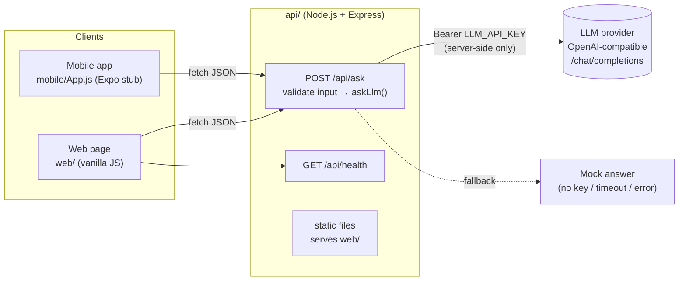

# Full-stack web + API + mobile + AI integration demo

A deliberately small monorepo that shows the whole path end to end: a **web page** and a **React Native (Expo) app** call **one API endpoint**, and that endpoint calls an **LLM**. The API key is configured through environment variables, and a **mock fallback** keeps the demo working with no key and no network.

Built by **Mihai Chindriș**, software engineer and tutor (BSc Computer Science, TU Cluj 2019; MSc Business Intelligence, TU Wien, in progress).

## Architecture



Request flow: the client sends `{ "question": "..." }`. The API validates it (non-empty, ≤ 2000 chars) and calls the LLM with a timeout. It returns `{ answer, source: "llm" | "mock", model, reason?, latencyMs }`. The key never leaves the server.

## Repo layout

```
api/
  src/app.js        Express app: CORS, /api/health, /api/ask, static web, JSON error handling
  src/llm.js        OpenAI-compatible client + mock fallback (never throws)
  src/server.js     entry point, loads api/.env
  test/api.test.js  node:test suite (7 tests, no network needed)
  .env.example      LLM_API_KEY, LLM_BASE_URL, LLM_MODEL, ...
web/                index.html + app.js + styles.css (no build step)
mobile/             Expo/React Native App.js stub + setup notes
ci/                 GitHub Actions workflow (move to .github/workflows to enable)
```

## Run it

Requires Node.js ≥ 20.12.

```bash
npm run setup          # installs api dependencies (just Express)
npm start              # http://localhost:3000 serves API + web page, in MOCK mode
npm test               # 7 tests: endpoints, validation, CORS, LLM parsing, fallbacks
```

To use a real model:

```bash
cp api/.env.example api/.env
# edit api/.env → LLM_API_KEY=sk-...   (optionally LLM_BASE_URL / LLM_MODEL)
npm start              # banner shows: mode: LLM (gpt-4o-mini)
```

`LLM_BASE_URL` can point to any OpenAI-compatible Chat Completions API (OpenAI, OpenRouter, Groq, a local Ollama at `http://localhost:11434/v1`, ...).

Try it with curl:

```bash
curl -s localhost:3000/api/ask -H 'Content-Type: application/json' -d '{"question":"What is an API?"}'
# {"answer":"[mock] You asked: \"What is an API?\" (4 words). Set LLM_API_KEY ...","source":"mock",...}
```

Mobile: see [mobile/README.md](mobile/README.md). Run `npx create-expo-app`, copy `App.js`, and set `EXPO_PUBLIC_API_URL`.

## Design choices worth discussing in a session

- **One endpoint, one contract.** Web and mobile share the same JSON shape, so adding a client doesn't touch the server.
- **The AI is a dependency, not the app.** `askLlm()` is injectable (`createApp({ ask })`) and never throws. Timeouts and upstream errors degrade to a mock answer, so the UI never breaks.
- **Secrets stay server-side.** No key in the browser or the mobile bundle. Upstream error bodies are logged, not forwarded to clients.
- **Untrusted model output.** The web page renders answers with `textContent`, never `innerHTML`.
- **Testable without the internet.** `fetch` is injected in tests, so CI needs no API key.

## How I'd help

- **Map your project end to end.** We start from your idea or existing code and draw the same kind of diagram: clients, API, data, AI provider. That way you know where every piece lives and why.
- **Build in vertical slices.** One feature at a time through every layer (UI → API → DB/AI → back), with tests. Each session ends with something running.
- **API design and integration.** REST contracts, validation, auth, error handling, CORS, environment config, and deploying the API somewhere real.
- **Mobile with React Native / Expo.** Sharing logic with the web client, device networking quirks, builds and store-readiness basics.
- **AI integration done properly.** Prompting, streaming, timeouts and fallbacks, cost and rate limits, keeping keys safe, and evaluating answers instead of trusting them.
- **Explaining the why.** I review your code with you and explain trade-offs, so you can keep building on your own between sessions.

## License

MIT. See [LICENSE](LICENSE).
